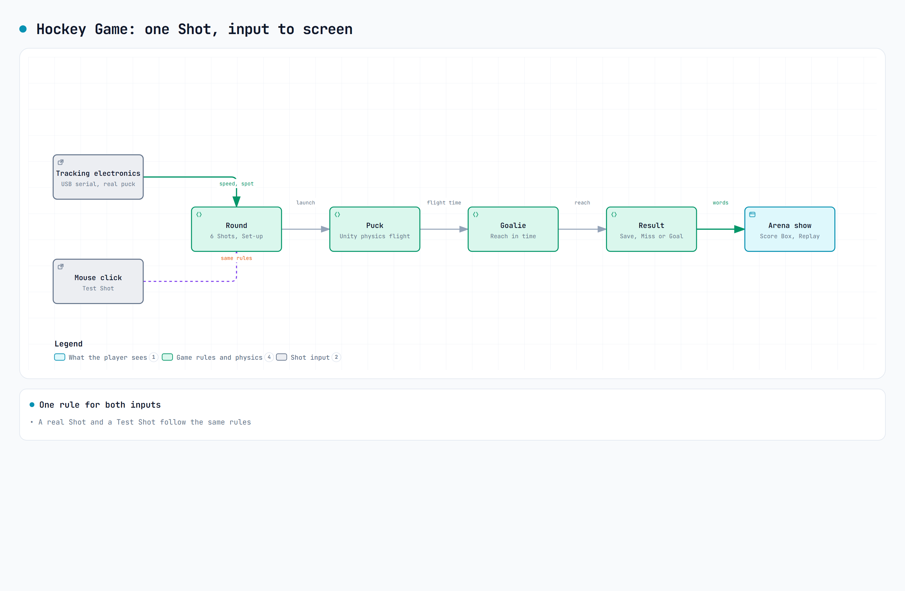

# Hockey Game Test

A 3D hockey game where the player shoots a real puck at a goalie. Tracking electronics report each real shot as a speed and a spot on the net. The game decides the result. It runs in Unity 6 on a Windows PC and as a Web build in a browser.

**Status: personal prototype, built for fun.**

[GLOSSARY.md](GLOSSARY.md) | [Decisions (ADRs)](docs/adr/) | [Credits](CREDITS.md) | [Issues](../../issues)



## ⚙️ How It Works

1. **Shot in.** The tracking electronics send a speed and a Net Face spot over USB serial. A mouse click makes a Test Shot with the same rules.
2. **Round.** One Round is 6 Shots. Each Shot gets a new goalie Set-up and Attack Side.
3. **Puck flight.** Unity physics moves the puck from the shooter to the net. Physics decides the Shot.
4. **Goalie.** The goalie reacts to the Shot. The Shot is a Save or a Goal by whether the goalie can reach it in time.
5. **Result.** The game shows Save, Miss or Goal as a word with sound. The goalie plays a Save Reaction, Annoyed Gesture or Relief.
6. **Arena show.** The Score Box, Replay and crowd show the result. The best score is saved between runs.

The game logic is in plain C# under `Assets/Scripts/Core`. The Unity scene code is in `Assets/Scripts/Game`.

## ✨ Features

- Round of 6 Shots with a Score Box, Replay and Goal Show.
- Real puck Shots over USB serial, or Test Shots with the mouse.
- Test Mode: endless full-speed Shots for tuning the goalie.
- Pause with Esc during a Round.
- Settings page with a Player part and a Dev part.
- Full arena: rink, boards, ads, video board and 3D crowd.

## 🔩 Hardware

This is a game, not a rig. The table lists the platform it runs on.

| Part | Choice |
|---|---|
| Computer | Windows PC |
| Engine | Unity 6000.6.5f1, Universal Render Pipeline 17.6 |
| Input library | Unity Input System 1.20.1 |
| Keyboard and mouse | Menus, Pause, Test Shots |
| Tracking electronics | USB serial, 115200 baud, one text line per Shot |
| Web host | Raspberry Pi `gs-sandbox`, nginx on port 80 |

- **Keyboard and mouse** are enough to play with Test Shots. No other hardware is needed.
- **Tracking electronics** are optional. The game finds the serial port by itself in Auto mode.
- **Web host** serves the Web build to the local network. There is no multiplayer. Each player runs the game in their own browser.

## 🧰 Setup

### Requirements

| Item | Version |
|---|---|
| Unity Editor | 6000.6.5f1 |
| Unity modules | Web Build Support (for the Web build) |
| Python 3 | Only for the asset scripts in `Tools/` |
| Pillow, numpy | From `Tools/requirements.txt`, only for the asset scripts |
| `scp` and SSH key login to `gs-sandbox` | Only to publish the Web build |

### Steps

1. Clone the repository.
2. Open the project folder in Unity Hub with Unity 6000.6.5f1.
3. Wait for the first import to finish.
4. Open `Assets/Scenes/Rink.unity`. This is the only scene in the build.
5. Press Play.

### Build and publish the Web build

1. In the Unity Editor, choose File > Build Profiles > Web > Build.
2. Build into `C:\Users\garrett.reynolds\HockeyWeb`.
3. Turn on Player Settings > Publishing Settings > Decompression Fallback. Plain nginx sends no Content-Encoding header.
4. Copy the build to the Raspberry Pi:

```powershell
scp -r C:\Users\garrett.reynolds\HockeyWeb\* gs-sandbox:/var/www/html/hockey/
```

5. Open `http://gs-sandbox.localdomain/hockey/` in a browser on the local network.

### Verifying it worked

```text
Rink scene opens, the start screen shows, a click starts a Round.
```

With Test Shots on, a click in the Round launches the puck. The goalie reacts and the Score Box updates. After 6 Shots the end screen shows.

### Gotchas

- **Decompression Fallback.** Turn it on before you build for the Pi. The page does not load without it.
- **Web URL.** The game is not uploaded yet. The URL above can return 404 until the first copy.
- **Folder owner.** `/var/www/html/hockey` on the Pi belongs to user `pi`. Copy as that user.
- **Batch mode.** Do not run Unity in batch mode for this project. Use the open Editor.
- **Assets.** The code-made placeholders replace any model or sound that is missing. `CREDITS.md` lists each supplied file.

## ⚡ Quickstart

Open the project in the Unity Editor and open `Assets/Scenes/Rink.unity`. Press Play, then use these keys and clicks.

| Input | Action |
|---|---|
| Any key or click | Start a Round from the start screen |
| F1 | Turn Test Shots on or off |
| Mouse click | Shoot a Test Shot at the pointer (Test Shots on) |
| Mouse wheel | Change the Test Shot speed (Test Shots on) |
| Esc | Pause during a Round; back to the start screen in Test Mode |
| F2 | Open or close the Settings page from the start screen |

To run the Edit Mode tests, choose Window > General > Test Runner > EditMode > Run All.

## 📁 Project structure

| Path | What it holds |
|---|---|
| `Assets/Scenes/Rink.unity` | The scene in the build |
| `Assets/Scripts/Core/` | Game rules in plain C#: Round, goalie reach, Net Face Gaps |
| `Assets/Scripts/Game/` | Unity code: puck physics, goalie, rink, USB input, screens |
| `Assets/Tests/EditMode/` | Edit Mode tests |
| `Assets/Editor/PlayCheck/` | Editor tool that plays a scripted Round |
| `Assets/InputSystem_Actions.inputactions` | Unity default input actions asset |
| `Tools/` | Python scripts that make models, textures and sounds |
| `docs/adr/` | Architecture decision records |
| `docs/agents/` | Notes for coding agents |
| `GLOSSARY.md` | The game's words: Round, Shot, Net Face and more |
| `CREDITS.md` | Source and licence of each supplied asset |

## 📚 Documentation

- [GLOSSARY.md](GLOSSARY.md): the domain words used in code and docs.
- [docs/adr/](docs/adr/): why the goalie, reach and physics work as they do.
- [GitHub Issues](../../issues): open work and status. The project has no NEXT_STEPS.md or DECISIONS.md.
- [docs/hockey-game.html](docs/hockey-game.html): the diagram as a web page.
- [CREDITS.md](CREDITS.md): asset sources and licences.
- [Tools/README.md](Tools/README.md): the asset scripts and their commands.

<!-- create-readme v0.2.5 -->
